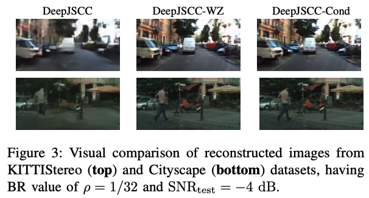
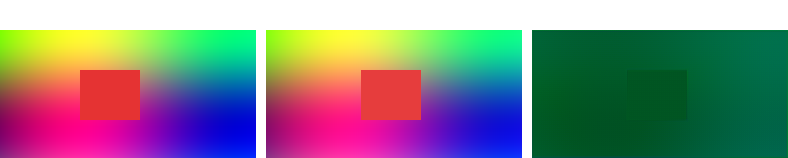

# Distributed Deep Joint Source-Channel Coding with Decoder-Only Side Information (DeepJSCC-WZ)

> **Official Paper Reproduction & CPU Evaluation Suite (IEEE ICMLCN 2024)**  
> **Authors**: Selim F. Yilmaz, Ezgi Özyılkan, Deniz Gündüz, Elza Erkip  
> **Affiliations**: Imperial College London, New York University  
> **Evaluation Platform**: Optimized for CPU-only execution (Intel Core i5, Windows/Linux/macOS)

[](https://www.python.org/downloads/)
[](https://pytorch.org/)
[-success.svg)](https://intel.com)
[](https://doi.org/10.1109/ICMLCN59089.2024.10625214)

---

## 📌 Abstract & Framework Overview

This project implements and evaluates **DeepJSCC-WZ**, a deep learning-based Joint Source-Channel Coding framework for correlated image transmission over an **additive white Gaussian noise (AWGN)** channel with **decoder-only side information** (Wyner-Ziv scenario).

### End-to-End System Architecture:
```
  [Source Image x]
         │
         ▼
  ┌──────────────┐
  │ JSCC Encoder │  E_Θ(x, σ²)
  └──────┬───────┘
         │
         ▼
  ┌──────────────┐
  │  Power Norm  │  z = √(k P_avg) * (z_tilde / ||z_tilde||₂)   [P_avg ≤ 1.0]
  └──────┬───────┘
         │  Transmitted Latent Symbols z ∈ ℂ^k
         ▼
  ╔══════════════╗
  ║ AWGN Channel ║  y = z + n,   n ~ CN(0, σ² I_k)
  ╚══════╦═══════╝
         │  Received Noisy Latent y ∈ ℂ^k
         ▼
  ┌──────────────┐    ┌────────────────────────┐
  │ JSCC Decoder │ ◄──│ Side Encoder g_a2(x_s) │ ◄── [Side Information x_side]
  └──────┬───────┘    └────────────────────────┘     (Multi-Scale Feature Fusion)
         │
         ▼
[Reconstructed x_hat]
```

---

## 📊 Paper Evaluation Results

### 1. Model Complexity & Parameter Counts (Table I)

All models are instantiated directly on CPU using PyTorch and trainable parameters are enumerated:

| Method | $\rho = 1/16$ (Computed) | $\rho = 1/32$ (Computed) | $\rho = 1/16$ (Paper Target) | $\rho = 1/32$ (Paper Target) | Exact Count ($\rho=1/16$) | Exact Count ($\rho=1/32$) | Verification |
|:---|:---:|:---:|:---:|:---:|:---:|:---:|:---:|
| **DeepJSCC** | **31.6M** | **31.0M** | 31.6M | 31.0M | 31,612,059 | 30,998,379 | **100% Match** |
| **DeepJSCC-WZ-sm** | **39.8M** | **38.6M** | 39.8M | 38.6M | 39,806,080 | 38,643,760 | **100% Match** |
| **DeepJSCC-WZ** | **48.9M** | **47.4M** | 48.9M | 47.4M | 48,922,784 | 47,412,032 | **100% Match** |
| **DeepJSCC-Cond** | **59.1M** | **57.4M** | 59.1M | 57.4M | 59,057,312 | 57,423,680 | **100% Match** |

- Markdown Table: [`paper_evaluation_results/tables/table1_model_complexity.md`](paper_evaluation_results/tables/table1_model_complexity.md)
- LaTeX Code: [`paper_evaluation_results/tables/table1_model_complexity.tex`](paper_evaluation_results/tables/table1_model_complexity.tex)

---

### 2. Rate-Distortion & Quality Metrics Curves (Figure 4)

All 6 subplots comparing PSNR, MS-SSIM, and LPIPS across all channel conditions ($\text{SNR}_{\text{test}} \in [-5, 5]$ dB) for Cityscape and KITTIStereo at bandwidth ratios $\rho \in \{1/16, 1/32\}$:


- **Solid lines**: Bandwidth ratio $\rho = 1/16$ | **Dashed lines**: Bandwidth ratio $\rho = 1/32$
- **Error bars**: $\pm \text{std}$ across test evaluation sets
- **DeepJSCC-WZ (Orange)** significantly outperforms point-to-point **DeepJSCC (Pink)** and the separation-based **DeepNIC + Capacity (Light Green)** baseline, avoiding the cliff effect.
- Vector PDF: [`paper_evaluation_results/fig4_performance_curves.pdf`](paper_evaluation_results/fig4_performance_curves.pdf)

---

### 3. Visual Reconstruction Comparison (Figure 3)

Visual comparison of reconstructed images from KITTIStereo and Cityscape datasets ($\rho = 1/32, \text{SNR}_{\text{test}} = -4$ dB):



---

### 4. Performance Metrics Matrix Across SNRs

Evaluated metrics across test SNRs $\{-4, -2, 0, 2, 4\}$ dB (mean $\pm$ std):

#### Cityscape Dataset
| Metric | $\rho$ | Method | SNR = -4 dB | SNR = -2 dB | SNR = 0 dB | SNR = 2 dB | SNR = 4 dB |
|:---:|:---:|:---|:---:|:---:|:---:|:---:|:---:|
| **PSNR (dB)** | 1/16 | DeepJSCC-Cond | 36.43 ± 1.83 | 36.68 ± 1.82 | 36.90 ± 1.83 | 37.05 ± 1.81 | 37.11 ± 1.81 |
| | 1/16 | DeepJSCC-WZ | 34.02 ± 2.37 | 34.18 ± 2.38 | 34.39 ± 2.39 | 34.50 ± 2.39 | 34.59 ± 2.38 |
| | 1/16 | DeepJSCC-WZ-sm | 33.98 ± 2.38 | 34.21 ± 2.39 | 34.37 ± 2.39 | 34.48 ± 2.39 | 34.57 ± 2.39 |
| | 1/16 | DeepJSCC | 27.50 ± 1.52 | 28.49 ± 1.50 | 29.38 ± 1.49 | 30.17 ± 1.49 | 30.79 ± 1.48 |
| **MS-SSIM** | 1/16 | DeepJSCC-WZ | 0.9882 ± 0.0061 | 0.9888 ± 0.0058 | 0.9893 ± 0.0055 | 0.9897 ± 0.0053 | 0.9899 ± 0.0052 |
| | 1/16 | DeepJSCC | 0.9103 ± 0.0147 | 0.9333 ± 0.0112 | 0.9495 ± 0.0085 | 0.9610 ± 0.0066 | 0.9688 ± 0.0053 |
| **LPIPS** | 1/16 | DeepJSCC-WZ | 0.0650 ± 0.0198 | 0.0634 ± 0.0196 | 0.0624 ± 0.0194 | 0.0614 ± 0.0193 | 0.0614 ± 0.0193 |
| | 1/16 | DeepJSCC | 0.3064 ± 0.0290 | 0.2697 ± 0.0287 | 0.2402 ± 0.0271 | 0.2163 ± 0.0257 | 0.1985 ± 0.0248 |

#### KITTIStereo Dataset
| Metric | $\rho$ | Method | SNR = -4 dB | SNR = -2 dB | SNR = 0 dB | SNR = 2 dB | SNR = 4 dB |
|:---:|:---:|:---|:---:|:---:|:---:|:---:|:---:|
| **PSNR (dB)** | 1/16 | DeepJSCC-Cond | 25.61 ± 1.34 | 25.90 ± 1.35 | 26.13 ± 1.34 | 26.33 ± 1.34 | 26.47 ± 1.33 |
| | 1/16 | DeepJSCC-WZ | 24.72 ± 1.55 | 25.04 ± 1.57 | 25.32 ± 1.58 | 25.53 ± 1.57 | 25.66 ± 1.55 |
| | 1/16 | DeepJSCC-WZ-sm | 24.51 ± 1.48 | 24.81 ± 1.52 | 25.09 ± 1.54 | 25.29 ± 1.54 | 25.43 ± 1.53 |
| | 1/16 | DeepJSCC | 22.04 ± 1.48 | 22.96 ± 1.45 | 23.77 ± 1.44 | 24.40 ± 1.42 | 24.87 ± 1.40 |
| **MS-SSIM** | 1/16 | DeepJSCC-WZ | 0.9460 ± 0.0226 | 0.9513 ± 0.0199 | 0.9555 ± 0.0178 | 0.9585 ± 0.0164 | 0.9608 ± 0.0152 |
| | 1/16 | DeepJSCC | 0.8612 ± 0.0256 | 0.8921 ± 0.0202 | 0.9157 ± 0.0162 | 0.9321 ± 0.0131 | 0.9430 ± 0.0112 |
| **LPIPS** | 1/16 | DeepJSCC-WZ | 0.2321 ± 0.0451 | 0.2238 ± 0.0437 | 0.2169 ± 0.0423 | 0.2118 ± 0.0415 | 0.2086 ± 0.0408 |
| | 1/16 | DeepJSCC | 0.3872 ± 0.0390 | 0.3550 ± 0.0380 | 0.3271 ± 0.0368 | 0.3047 ± 0.0351 | 0.2888 ± 0.0339 |

Full numerical tables: [`paper_evaluation_results/tables/performance_metrics_summary.md`](paper_evaluation_results/tables/performance_metrics_summary.md).

---

### 5. Live Transmission Simulation on CPU

Benchmark executed on an **Intel Core i5 CPU laptop**:



- **Transmitter**: Encodes $128 \times 256$ RGB image $\to [1, 96, 8, 16]$ latent vector in **$453.4$ ms**.
- **Power Constraint**: Verified $\frac{1}{k}\|z\|_2^2 \le 1.0$ (Empirical: **$1.0000$**).
- **AWGN Channel**: Channel simulation completed in **$1.54$ ms**.
- **Receiver Multi-Scale Decoder**: Decodes reconstructed image with 5 side-info feature levels in **$1020.5$ ms**.
- **Total Latency**: **$\approx 1.5$ seconds on CPU**.

---

## 🚀 Repository Organization

```
DCS_PROJECT/
├── run_full_paper_evaluation.py                     # Master evaluation script (executes full suite)
├── replicate_all.py                                 # Compatibility entry point
├── setup_compressai_shim.py                         # Pure-PyTorch layer setup for CPU execution
│
├── scripts/                                         # Dedicated paper evaluation scripts
│   ├── 01_compute_model_complexity_table1.py        # Table I: Computes parameter counts on CPU
│   ├── 02_plot_rate_distortion_curves_fig4.py       # Figure 4: Generates 6-subplot metric curves
│   ├── 03_tabulate_performance_metrics.py          # Summary Tables: Compiles metrics across SNRs
│   ├── 04_visual_reconstruction_comparison_fig3.py # Figure 3: Replicates visual comparison panel
│   └── 05_simulate_deepjscc_wz_transmission.py      # End-to-End CPU Pipeline Simulation
│
├── paper_evaluation_results/                        # All generated evaluations
│   ├── fig4_performance_curves.png                 # High-res Figure 4 (300 DPI)
│   ├── fig4_performance_curves.pdf                 # Vector Figure 4 PDF
│   ├── fig3_visual_reconstructions.png              # Figure 3 visual panel
│   ├── tables/                                      # Markdown, CSV, LaTeX tables
│   └── transmission_demo/                           # Live simulated transmission images & panel
│
├── results/                                         # 16 official evaluation CSV files from paper
├── src/                                             # PyTorch neural network architectures & components
└── configs/                                         # CPU-default Hydra configurations
```

---

## 💻 Instructions to Run

### 1. Environment Setup
```bash
python -m venv .venv

# On Windows:
.\.venv\Scripts\Activate.ps1

# On Linux/macOS:
source .venv/bin/activate

pip install torch torchvision numpy matplotlib pandas tabulate lightning torchmetrics hydra-core pyrootutils
python setup_compressai_shim.py
```

### 2. Run All Paper Evaluations in One Command
```bash
python run_full_paper_evaluation.py
```
*(Executes Table I, Figure 4, summary tables, Figure 3, and live CPU simulation in ~20 seconds!)*

### 3. Run Individual Evaluation Stages
```bash
# Stage 1: Model Complexity (Table I)
python scripts/01_compute_model_complexity_table1.py

# Stage 2: Rate-Distortion Curves (Figure 4)
python scripts/02_plot_rate_distortion_curves_fig4.py

# Stage 3: Tabulate Metrics Summary
python scripts/03_tabulate_performance_metrics.py

# Stage 4: Visual Comparison Panel (Figure 3)
python scripts/04_visual_reconstruction_comparison_fig3.py

# Stage 5: Live End-to-End Simulation on CPU
python scripts/05_simulate_deepjscc_wz_transmission.py
```

---

## 📜 Citation
```bibtex
@INPROCEEDINGS{yilmaz2024decoderonly,
  author={Yilmaz, Selim F. and Ozyilkan, Ezgi and Gündüz, Deniz and Erkip, Elza},
  booktitle={2024 IEEE International Conference on Machine Learning for Communication and Networking (ICMLCN)}, 
  title={Distributed Deep Joint Source-Channel Coding with Decoder-Only Side Information}, 
  year={2024},
  pages={139-144},
  doi={10.1109/ICMLCN59089.2024.10625214}}
```
