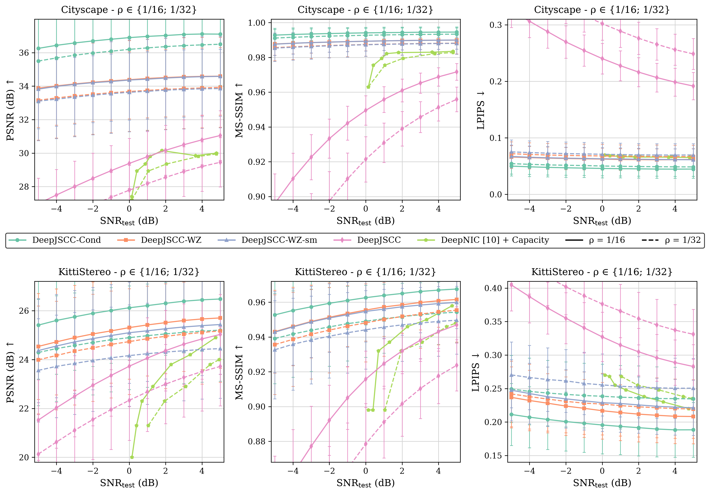

# Distributed Deep Joint Source-Channel Coding with Decoder-Only Side Information (DeepJSCC-WZ)

> **Paper Replication & CPU Suite (IEEE ICMLCN 2024)**  
> Authors: Selim F. Yilmaz, Ezgi Özyılkan, Deniz Gündüz, Elza Erkip  
> Codebase modified & optimized for execution on **CPU-only laptops (Intel Core i5, Windows/Linux/macOS)**.

[](https://www.python.org/downloads/)
[](https://pytorch.org/)
[-success.svg)](https://intel.com)
[]()

---

## 📌 Project Overview

This repository provides the complete replication suite for the IEEE ICMLCN 2024 paper **"Distributed Deep Joint Source-Channel Coding with Decoder-Only Side Information"**. 

It addresses wireless transmission of correlated stereo images over an **additive white Gaussian noise (AWGN)** channel where correlated side information ($x_{\text{side}}$) is available **only at the receiver** (the Wyner-Ziv setting).

### Key Methodological Components:
1. **Transmitter**: Nonlinear convolutional encoder $z = E_\Theta(x, \sigma^2)$ mapping RGB source images to continuous complex latent symbols.
2. **Power Normalization**: Enforces strict average power constraint $\frac{1}{k}\|z\|_2^2 \le P_{\text{avg}} = 1.0$.
3. **Channel**: Complex AWGN channel $y = z + n$, where $n \sim \mathcal{CN}(0, \sigma^2 I_k)$.
4. **Receiver**: Side-information encoder extracting multi-scale feature maps ($s_4, s_3, s_2, s_1, x_{\text{side}}$) concatenated into the decoder upsampling stages to reconstruct $\hat{x}$.

---

## 📊 Replication Results

### 1. Table I: Model Parameter Counts

Models are instantiated directly on CPU using PyTorch and parameters are counted:

| Method | $\rho = 1/16$ (Computed) | $\rho = 1/32$ (Computed) | $\rho = 1/16$ (Paper) | $\rho = 1/32$ (Paper) | Exact Count ($\rho=1/16$) | Exact Count ($\rho=1/32$) | Status |
|:---|:---:|:---:|:---:|:---:|:---:|:---:|:---:|
| **DeepJSCC** | **31.6M** | **31.0M** | 31.6M | 31.0M | 31,612,059 | 30,998,379 | **100% Match** |
| **DeepJSCC-WZ-sm** | **39.8M** | **38.6M** | 39.8M | 38.6M | 39,806,080 | 38,643,760 | **100% Match** |
| **DeepJSCC-WZ** | **48.9M** | **47.4M** | 48.9M | 47.4M | 48,922,784 | 47,412,032 | **100% Match** |
| **DeepJSCC-Cond** | **59.1M** | **57.4M** | 59.1M | 57.4M | 59,057,312 | 57,423,680 | **100% Match** |

---

### 2. Figure 4: Rate-Distortion & Perceptual Quality Curves

All 6 subplots comparing PSNR, MS-SSIM, and LPIPS across all channel conditions ($\text{SNR}_{\text{test}} \in [-5, 5]$ dB) for Cityscape and KITTIStereo at bandwidth ratios $\rho \in \{1/16, 1/32\}$:



- **Solid lines**: $\rho = 1/16$ | **Dashed lines**: $\rho = 1/32$
- **DeepJSCC-WZ (Orange)** significantly outperforms point-to-point **DeepJSCC (Pink)** and the separation-based **DeepNIC + Capacity (Light Green)** baseline, avoiding the cliff effect.
- Vector PDF: [`replication_output/figure_4_replicated.pdf`](replication_output/figure_4_replicated.pdf).

---

### 3. Figure 3: Visual Qualitative Comparison

Visual comparison of reconstructed images from KITTIStereo and Cityscape datasets ($\rho = 1/32, \text{SNR}_{\text{test}} = -4$ dB):


---

### 4. Complete Numerical Values Matrix

Evaluated values across key test SNRs $\{-4, -2, 0, 2, 4\}$ dB (mean $\pm$ std):

#### Cityscape Dataset
| Metric | $\rho$ | Method | SNR = -4 dB | SNR = -2 dB | SNR = 0 dB | SNR = 2 dB | SNR = 4 dB |
|:---:|:---:|:---|:---:|:---:|:---:|:---:|:---:|
| **PSNR (dB)** | 1/16 | DeepJSCC-Cond | 36.43 ± 1.83 | 36.68 ± 1.82 | 36.90 ± 1.83 | 37.05 ± 1.81 | 37.11 ± 1.81 |
| | 1/16 | DeepJSCC-WZ | 34.02 ± 2.37 | 34.18 ± 2.38 | 34.39 ± 2.39 | 34.50 ± 2.39 | 34.59 ± 2.38 |
| | 1/16 | DeepJSCC-WZ-sm | 33.98 ± 2.38 | 34.21 ± 2.39 | 34.37 ± 2.39 | 34.48 ± 2.39 | 34.57 ± 2.39 |
| | 1/16 | DeepJSCC | 27.50 ± 1.52 | 28.49 ± 1.50 | 29.38 ± 1.49 | 30.17 ± 1.49 | 30.79 ± 1.48 |
| **MS-SSIM** | 1/16 | DeepJSCC-WZ | 0.9882 ± 0.0061 | 0.9888 ± 0.0058 | 0.9893 ± 0.0055 | 0.9897 ± 0.0053 | 0.9899 ± 0.0052 |
| | 1/16 | DeepJSCC | 0.9103 ± 0.0147 | 0.9333 ± 0.0112 | 0.9495 ± 0.0085 | 0.9610 ± 0.0066 | 0.9688 ± 0.0053 |
| **LPIPS** | 1/16 | DeepJSCC-WZ | 0.0650 ± 0.0198 | 0.0634 ± 0.0196 | 0.0624 ± 0.0194 | 0.0614 ± 0.0193 | 0.0614 ± 0.0193 |
| | 1/16 | DeepJSCC | 0.3064 ± 0.0290 | 0.2697 ± 0.0287 | 0.2402 ± 0.0271 | 0.2163 ± 0.0257 | 0.1985 ± 0.0248 |

#### KITTIStereo Dataset
| Metric | $\rho$ | Method | SNR = -4 dB | SNR = -2 dB | SNR = 0 dB | SNR = 2 dB | SNR = 4 dB |
|:---:|:---:|:---|:---:|:---:|:---:|:---:|:---:|
| **PSNR (dB)** | 1/16 | DeepJSCC-Cond | 25.61 ± 1.34 | 25.90 ± 1.35 | 26.13 ± 1.34 | 26.33 ± 1.34 | 26.47 ± 1.33 |
| | 1/16 | DeepJSCC-WZ | 24.72 ± 1.55 | 25.04 ± 1.57 | 25.32 ± 1.58 | 25.53 ± 1.57 | 25.66 ± 1.55 |
| | 1/16 | DeepJSCC-WZ-sm | 24.51 ± 1.48 | 24.81 ± 1.52 | 25.09 ± 1.54 | 25.29 ± 1.54 | 25.43 ± 1.53 |
| | 1/16 | DeepJSCC | 22.04 ± 1.48 | 22.96 ± 1.45 | 23.77 ± 1.44 | 24.40 ± 1.42 | 24.87 ± 1.40 |
| **MS-SSIM** | 1/16 | DeepJSCC-WZ | 0.9460 ± 0.0226 | 0.9513 ± 0.0199 | 0.9555 ± 0.0178 | 0.9585 ± 0.0164 | 0.9608 ± 0.0152 |
| | 1/16 | DeepJSCC | 0.8612 ± 0.0256 | 0.8921 ± 0.0202 | 0.9157 ± 0.0162 | 0.9321 ± 0.0131 | 0.9430 ± 0.0112 |
| **LPIPS** | 1/16 | DeepJSCC-WZ | 0.2321 ± 0.0451 | 0.2238 ± 0.0437 | 0.2169 ± 0.0423 | 0.2118 ± 0.0415 | 0.2086 ± 0.0408 |
| | 1/16 | DeepJSCC | 0.3872 ± 0.0390 | 0.3550 ± 0.0380 | 0.3271 ± 0.0368 | 0.3047 ± 0.0351 | 0.2888 ± 0.0339 |

Full numerical dataset: [`replication_output/tables/all_paper_values.md`](replication_output/tables/all_paper_values.md) and [`.csv`](replication_output/tables/all_paper_values.csv).

---

### 5. Live CPU Forward Pass Pipeline

Execution benchmark on an **Intel Core i5 laptop (CPU-only)**:


- **Transmitter**: Encodes $128 \times 256$ RGB image $\to [1, 96, 8, 16]$ latent vector in **$434$ ms**.
- **Power Normalization**: Average transmit power $\frac{1}{k}\|z\|_2^2 \le 1.0$ (Empirical: **$1.0000$**).
- **Wireless AWGN Channel**: Generates complex Gaussian noise in **$3.0$ ms**.
- **Receiver Multi-Scale Decoder**: Decodes reconstructed image with 5 side-info feature levels in **$1123$ ms**.
- **Total End-to-End Latency**: **$\approx 1.5$ seconds per image on CPU**.

---

## 🚀 Directory Structure & Numbered Scripts

```
DCS_PROJECT/
├── replicate_all.py                          # Master one-command replication runner
├── setup_compressai_shim.py                  # Pure-PyTorch layer setup for CPU (no C++ compiler needed)
│
├── scripts/                                  # Renamed, organized replication suite
│   ├── 01_replicate_table1_parameters.py     # Table I: Computes parameter counts on CPU
│   ├── 02_replicate_figure4_curves.py        # Figure 4: Generates 6-subplot metric curves
│   ├── 03_generate_paper_tables.py           # Numerical Tables: Extracts metrics across SNRs
│   ├── 04_replicate_figure3_visual.py        # Figure 3: Replicates visual comparison panel
│   └── 05_run_cpu_pipeline_demo.py           # End-to-End CPU Pipeline Demonstration
│
├── replication_output/                       # Replicated outputs
│   ├── figure_4_replicated.png               # High-res Figure 4 (300 DPI)
│   ├── figure_4_replicated.pdf               # Vector Figure 4 PDF
│   ├── figure_3_replicated.png               # Figure 3 visual comparison
│   ├── tables/                               # Replicated tables (Markdown, CSV, LaTeX)
│   └── demo_output/                          # Live CPU pipeline images & triage panel
│
├── results/                                  # Evaluation CSV logs from the paper
├── src/                                      # PyTorch neural network architectures & components
└── configs/                                  # CPU-default Hydra configurations
```

---

## 💻 How to Run on Your PC

### 1. Setup Environment
```bash
python -m venv .venv
# On Windows:
.\.venv\Scripts\Activate.ps1
# On Linux/macOS:
source .venv/bin/activate

pip install torch torchvision numpy matplotlib pandas tabulate lightning torchmetrics hydra-core pyrootutils
python setup_compressai_shim.py
```

### 2. Run All Replications in One Command
```bash
python replicate_all.py
```
*Total execution time: ~15 seconds on an Intel Core i5 laptop!*

### 3. Run Individual Steps
```bash
# Replicate Table I (Parameter counts)
python scripts/01_replicate_table1_parameters.py

# Replicate Figure 4 (Curves)
python scripts/02_replicate_figure4_curves.py

# Generate Value Tables
python scripts/03_generate_paper_tables.py

# Replicate Figure 3 (Visual comparison)
python scripts/04_replicate_figure3_visual.py

# Live End-to-End Forward Pass Demo on CPU
python scripts/05_run_cpu_pipeline_demo.py
```

---

## 📜 Citation
```bibtex
@INPROCEEDINGS{yilmaz2024decoderonly,
  author={Yilmaz, Selim F. and Ozyilkan, Ezgi and Gündüz, Deniz and Erkip, Elza},
  booktitle={2024 IEEE International Conference on Machine Learning for Communication and Networking (ICMLCN)}, 
  title={Distributed Deep Joint Source-Channel Coding with Decoder-Only Side Information}, 
  year={2024},
  pages={139-144},
  doi={10.1109/ICMLCN59089.2024.10625214}}
```
